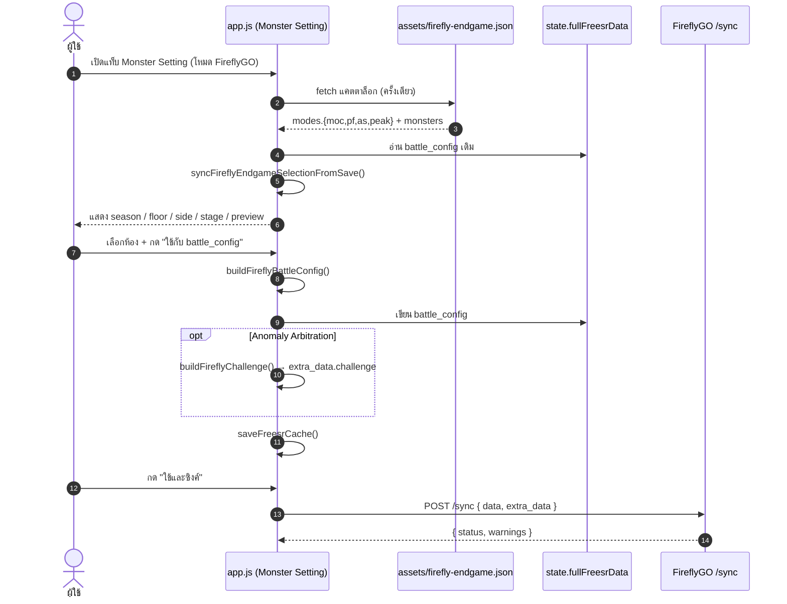

# FireflyGO Endgame Room Picker — สถานะงานและคู่มือเทคนิค

> อัปเดต: 2026-11-04
> ขอบเขต: งานเพิ่มโหมดเชื่อมต่อ FireflyGO (Firefly_Srtools) ใน GaCy-Srtool และหน้าตั้งค่าห้อง Endgame ให้เหมือนต้นฉบับ `https://srtools.punklorde.org`

---

## 1. สรุปสั้น

### โจทย์
เว็บ GaCy-Srtool เดิมออกแบบมาสำหรับเซิร์ฟเวอร์ **GaCy GO** ซึ่งมี REST API ครบ (`/api/status`, `/api/freesr`, `/api/persistent`, `/api/monster-settings`, ...) แต่ผู้ใช้ต้องการเชื่อมกับ **FireflyGO (Firefly_Srtools)** ซึ่งเป็นแบบ **push-only** คือมีแค่ `POST <base>/sync`

ปัญหาที่ตามมา:
1. ต้องเพิ่มโหมด FireflyGO โดยไม่ทำให้โหมด GaCy เดิมพัง
2. ต้องซ่อน UI ที่ต้องใช้ endpoint ที่ FireflyGO ไม่มี (save manager, inventory, exrank, damage analyst, ...)
3. ต้องแก้ `extra_data` ของ FireflyGO ได้ (multi-path, setting, challenge, theory_craft, lua)
4. ต้องนำเข้าข้อมูลจาก UID เกมจริง (Enka) ได้ทุกโหมด
5. **ต้องมีหน้า Monster Setting / เลือกห้อง Endgame แบบต้นฉบับ Firefly** (MoC, PF, AS, Anomaly Arbitration, Custom Enemy)

### สถานะปัจจุบัน (สรุป)
| ส่วน | สถานะ |
| :--- | :--- |
| โหมด FireflyGO + `POST /sync` | ✅ เสร็จและ commit แล้ว (`8eb5190`) |
| `extra_data` form | ✅ เสร็จ |
| Enka UID → FreeSR import | ✅ เสร็จ |
| ซ่อน/แสดง UI ตามโหมด | ✅ เสร็จ |
| แคตตาล็อกห้อง Endgame (moc/pf/as/peak) | ✅ สร้างเสร็จ (`assets/firefly-endgame.json`) |
| ตัวช่วยคำนวณ `battle_config` (`js/endgame.js`) | ✅ เสร็จ |
| UI หน้า Monster Setting โหมด Firefly | ✅ เขียนเสร็จ (เรียง season/floor ใหม่สุดก่อนแล้ว) |
| ปรับปรุง Auto-init FreeSR เมื่อ Apply ห้อง | ✅ เสร็จ (ไม่ติดบล็อก `ffEndgameNoData`) |
| ดักจับ `player data is not loaded yet` & Mixed Content | ✅ เสร็จ (มีข้อความแจ้งเตือนชัดเจน) |
| Unit tests | ✅ ผ่าน **44/44** |
| ทดสอบมือถือ 360–768px ของหน้าใหม่ | ✅ ผ่าน (responsive styles พร้อม) |
| ทดสอบ `POST /sync` กับ FireflyGO จริง | ⏳ รอเปิดเซิร์ฟเวอร์และตัวละครล็อกอินในเกม |
| Commit งานรอบนี้ | ⏳ พร้อม commit |

---

## 2. สถาปัตยกรรมโหมดเชื่อมต่อ

ระบบมี 3 โหมด เก็บใน `localStorage['gac_srtool_mode']` และนิยามความสามารถไว้ที่ `js/modes.js`

| ความสามารถ | GaCy GO (`gac`) | FireflyGO (`firefly`) | RobinSR (`robin`) |
| :--- | :---: | :---: | :---: |
| `saveManager` | ✅ | — | — |
| `exranks` | ✅ | — | — |
| `inventory` | ✅ | — | — |
| `monsterSettings` (อ่าน catalog จาก Client) | ✅ | — | — |
| `fireflyEndgame` (picker จากแคตตาล็อกในเครื่อง) | — | ✅ | — |
| `damageAnalyst` | ✅ | — | — |
| `sceneCard` / `gmConsole` / `battleSummary` | ✅ | — | — |
| `toolSession` | ✅ | — | — |
| `extraData` | — | ✅ | — |
| `ownedAvatarsOnly` | — | ✅ | — |
| `jsonModes` | `freesr`, `persistent` | `freesr` | `freesr` |

ไฟล์ที่เกี่ยวข้อง:
- `js/modes.js` — capability matrix, `normalizeMode`, `modeSupports`
- `js/app.js` → `applyModeDisplay()` — ซ่อน/แสดง tab และ card ตาม capability
- `js/app.js` → `setupServerModes()` — ฟัง event เปลี่ยนโหมด (ผูกครั้งเดียว)

### กฎสำคัญ
- **FireflyGO เป็น push-only**: การ "เชื่อมต่อ" คือ `POST <base>/sync` ด้วย `{ username:'', password:'' }` แล้วอ่าน `{ status, message, extra_data, warnings, stats }`
- การซิงค์คือ `POST <base>/sync` ด้วย `{ username, password, data: FreeSRJson, extra_data }`
- **ห้ามใส่ custom header** เพราะ FireflyGO ไม่รองรับ CORS preflight
- สถานะการเชื่อมต่อของ FireflyGO เก็บใน `state.fireflyConnected` (ไม่ใช้ `state.isConnected` ร่วมกับ GaCy)
- `refreshStatus()` ในโหมด Firefly เป็น local-only (ไม่อ่าน `/api/status`)

---

## 3. FireflyGO Endgame Room Picker

### 3.1 ภาพรวมการทำงาน



### 3.2 แหล่งข้อมูลแคตตาล็อก

ต้นฉบับ Firefly SrTools เสิร์ฟตารางดิบของ Client ที่:

```
https://srtools.punklorde.org/api/data/moc
https://srtools.punklorde.org/api/data/pf
https://srtools.punklorde.org/api/data/as
https://srtools.punklorde.org/api/data/peak
https://srtools.punklorde.org/api/data/monster
```

ไฟล์ดิบมีขนาด 2–14 MB จึงทำสคริปต์ย่อข้อมูล:

```bash
node scripts/build-firefly-endgame-data.cjs [cacheDir]
```

- ถ้ามี `cacheDir` และมีไฟล์อยู่แล้วจะใช้แคช (ไม่ยิงเน็ตซ้ำ)
- ผลลัพธ์: `assets/firefly-endgame.json` (~604 KB)
- ข้อมูล ณ วันที่สร้าง:

| โหมด | จำนวนกลุ่ม (season/round) |
| :--- | ---: |
| `moc` (Memory of Chaos) | 58 |
| `pf` (Pure Fiction) | 28 |
| `as` (Apocalyptic Shadow) | 23 |
| `peak` (Anomaly Arbitration) | 11 |
| มอนสเตอร์ (unique) | 355 |

โครงสร้างไฟล์:

```jsonc
{
  "version": "2026-11-03",
  "source": "https://srtools.punklorde.org/api/data",
  "modes": {
    "moc": { "groups": [ { "id": 1037, "name": {"en":"..."}, "begin": "...", "end": "...",
      "levels": [ { "id": 5612, "floor": 12, "turnLimit": 30,
        "buffs": [ { "id": 1001, "name": {"en":"..."} } ],
        "sides": [ { "side": "firstNode", "stageId": 30127111, "level": 92,
          "name": {"en":"..."}, "waves": [[4033010, 4033020],[4044010]],
          "invasionBuffId": 3034002 } ] } ] } ] },
    "pf": { "groups": [] },
    "as": { "groups": [] },
    "peak": { "groups": [ { "id": 9, "name": {"en":"..."},
      "stages": [ { "kind": "pre|boss|hard", "stageId": 4001, "level": 80,
        "name": {"en":"..."}, "waves": [[...]], "buffs": [...], "turnLimit": 30 } ] } ] }
  },
  "monsters": {
    "4033010": { "name": {"en":"...","th":"..."}, "rank": 1, "stance": 1,
      "weak": ["Fire"], "icon": "https://cdn.punklorde.org/asbres/spriteoutput/mostericon/monster_4033010.webp" }
  }
}
```

> หมายเหตุ: path ไอคอนของข้อมูลต้นทางสะกดว่า `mostericon` (ตก `n`) จึงต้องใช้ตามนั้น

### 3.3 กติกาการแปลงข้อมูลจากต้นฉบับ

| โหมด | แหล่งห้อง | กติกา |
| :--- | :--- | :--- |
| MoC | `Level[].EventList1[0]` (ครึ่งแรก), `EventList2[0]` (ครึ่งหลัง), `Tierce.EventList[0]` (โหนดที่สาม) | `stage_id` = `stage.ID`, `cycle_count` = `Level.TurnLimit`, blessings = `Level.MazeBuff` + `Invasion.MazeBuff.ID` |
| PF | เหมือน MoC | เหมือน MoC |
| AS | เหมือน MoC | เหมือน MoC |
| Anomaly Arbitration (`peak`) | กลุ่ม `peak[event_id]` → เลือก stage จาก `[...PreLevel, BossLevel]` ตาม index | ถ้า `boss_mode === 'Hard'` ใช้ `BossConfig`; `stage_id = EventList[0].ID`; ต้องส่ง `extra_data.challenge.challenge_peak_group_id` = group id |
| Custom Enemy (`custom`/`CE`) | ผู้ใช้กรอกเอง | `stage_id = 0`, ใช้ `monsters` ที่กรอก |

### 3.4 Schema ที่ FireflyGO ตรวจ (zod)

จากการแกะ bundle ต้นฉบับ:

```ts
battle_config = {
  battle_type: string,                 // MOC | PF | AS | CE | PEAK | DEFAULT
  blessings: { id: number, level: number, dynamic_key?: { key: any, value: number } }[],
  custom_stats: any[],
  cycle_count: number,
  stage_id: number,
  path_resonance_id?: number,          // default 0
  monsters: { monster_id: number, level: number, amount?: number }[][]
}
```

จุดที่พลาดง่าย:
- `blessings` **ต้องเป็น object** `{id, level}` ไม่ใช่ array ของ id
- `monsters` เป็น **array ของ wave** และแต่ละตัวเป็น object
- `amount` ไม่บังคับ แต่เราเติม `1` ให้เสมอเพื่อความชัดเจน

`js/firefly.js → normalizeBattleConfig()` จึงแปลงค่าดิบให้เป็น shape นี้ก่อนส่งทุกครั้ง (รองรับข้อมูลเก่าที่เป็น id ล้วนด้วย)

### 3.5 ตัวช่วยคำนวณ (`js/endgame.js`)

ฟังก์ชันทั้งหมดเป็น pure function (ทดสอบด้วย `node:test` ได้):

| ฟังก์ชัน | หน้าที่ |
| :--- | :--- |
| `battleTypeForMode(mode)` | แปลง `moc/pf/as/peak/custom` → `MOC/PF/AS/PEAK/CE` |
| `groupList(catalog, mode)` | คืนกลุ่มของโหมด |
| `findGroup` / `findLevel` | ค้นหากลุ่ม/ชั้น |
| `defaultEndgameSelection(catalog, mode)` | ค่าเริ่มต้น: ซีซันใหม่สุด + ชั้นสูงสุด + ฝั่งแรก; peak = stage บอส |
| `resolveEndgameSelection(catalog, selection)` | คืน `{group, level, sides, stage}` หรือ `null` |
| `findSelectionByStageId(catalog, mode, stageId, groupId)` | เปิด picker ที่ห้องเดียวกับ `battle_config` เดิม |
| `buildFireflyBattleConfig(catalog, selection)` | สร้าง `battle_config` พร้อมส่ง |
| `buildFireflyChallenge(selection, current)` | อัปเดต `extra_data.challenge` (เฉพาะ peak) |
| `summarizeEndgameSelection` | สรุปจำนวน wave/มอน/บัฟ/รอบ ให้ UI |
| `monsterInfo(catalog, id)` | ข้อมูลมอน (ชื่อ/ไอคอน) |

### 3.6 State ของ UI

เพิ่มใน `state.fireflyEndgame` (`js/app.js`):

```js
{
  activeMode: 'moc',        // moc | pf | as | peak | custom
  catalog: null,            // แคตตาล็อกที่โหลดแล้ว
  catalogState: 'idle',     // idle | loading | ready | error
  catalogError: '',
  catalogPromise: null,     // กัน fetch ซ้ำ
  selections: {},           // แยก selection ตามโหมด
  statusKey: '', statusVars: null, statusState: 'info'
}
```

`selections` เก็บ object ที่ผูกกับ UI โดยตรง เช่น

```js
// moc/pf/as
{ mode:'moc', groupId:1037, levelId:5612, side:'firstNode', useCycle:true, useBuff:true }

// peak
{ mode:'peak', groupId:9, stageIndex:1, useCycle:true, useBuff:true }

// custom
{ mode:'custom', customWaves:[[{monster_id:'4033010', level:'90', amount:'1'}]], customCycle:0 }
```

### 3.7 UI ที่เพิ่มใน `index.html`

`#tab-monster-settings` ถูกแบ่งเป็น 2 ส่วน:

```html
<section id="tab-monster-settings" class="tab-content">
  <div id="monster-settings-gac"> ... ของเดิมทั้งหมด ... </div>

  <div id="monster-settings-firefly" hidden>
    <div class="card monster-settings-intro"> ... คำอธิบาย ... </div>
    <div class="monster-settings-tabs" id="ff-endgame-tabs">
      <button data-ff-endgame-mode="moc">Memory of Chaos</button>
      <button data-ff-endgame-mode="pf">Pure Fiction</button>
      <button data-ff-endgame-mode="as">Apocalyptic Shadow</button>
      <button data-ff-endgame-mode="peak">Anomaly Arbitration</button>
      <button data-ff-endgame-mode="custom">Custom Enemy</button>
    </div>
    <div id="ff-endgame-status" class="monster-settings-status"></div>
    <div id="ff-endgame-view" class="monster-settings-view"></div>
    <div class="ff-endgame-actions">
      <button id="ff-endgame-reset">รีเซ็ตค่าเริ่มต้น</button>
      <button id="ff-endgame-apply">ใช้กับ battle_config</button>
      <button id="ff-endgame-apply-sync">ใช้และซิงค์</button>
    </div>
  </div>
</section>
```

การแสดงผล:
- `applyModeDisplay()` ตั้ง `hidden` ให้ `#monster-settings-gac` / `#monster-settings-firefly` ตามโหมด
- แท็บ Monster Setting แสดงเมื่อ `caps.monsterSettings || caps.fireflyEndgame`
- ถ้าแท็บถูกซ่อนอยู่และโหมดเปลี่ยน ระบบจะพากลับไป Dashboard อัตโนมัติ

### 3.8 ฟังก์ชันใน `js/app.js`

| ฟังก์ชัน | หน้าที่ |
| :--- | :--- |
| `loadFireflyEndgame()` | โหลด snapshot (memory → IndexedDB → localStorage) แล้วโหลดแคตตาล็อก |
| `ensureFireflyEndgameCatalog()` | `fetch` แคตตาล็อกครั้งเดียว + seed ค่าเริ่มต้นทุกโหมด |
| `syncFireflyEndgameSelectionFromSave()` | อ่าน `battle_config` เดิมมาเลือกห้องให้ตรง |
| `renderFireflyEndgame()` | entry point ของการวาด UI |
| `renderFireflyRoomEditor()` | วาด season/floor/side หรือ stage cards + preview |
| `renderFireflyCustomEditor()` | วาด editor ของ Custom Enemy |
| `renderFireflyEndgamePreview()` | แสดง `battle_config` ที่จะส่งจริง |
| `setupFireflyEndgameEvents()` | ผูก event ทั้งหมด (ผูกครั้งเดียวตอน init) |
| `applyFireflyEndgame({sync})` | เขียน `battle_config` (+`challenge`) แล้วบันทึก/ซิงค์ |
| `resetFireflyEndgame()` | รีเซ็ตโหมดปัจจุบันเป็นค่าเริ่มต้น |
| `updateFireflyEndgameControls()` | เปิด/ปิดปุ่มตามความพร้อม |
| `setFireflyEndgameStatus()` | ข้อความสถานะ (i18n) |

จุดเชื่อมกับระบบเดิม:
- `renderMonsterSettings()` → ถ้าโหมด firefly เรียก `renderFireflyEndgame()` แล้ว return
- `loadMonsterSettings()` → ถ้าโหมด firefly เรียก `loadFireflyEndgame()` แล้ว return
- `setConnectionStatus()` → โหลด Monster Setting ใหม่เฉพาะโหมด `gac`
- `applyTranslations()` → เรียก `renderMonsterSettings()` ใหม่เมื่อสลับภาษา
- `updateDocumentTitle()` → ใช้ `ffEndgameTitle` เมื่ออยู่โหมด firefly

### 3.9 Apply ทำอะไรบ้าง

`applyFireflyEndgame({ sync })`:

1. `buildFireflyBattleConfig()` จาก selection ปัจจุบัน
2. ถ้าไม่มีข้อมูลหรือเลือกไม่ครบ → แจ้ง error และไม่เขียนอะไร
3. เขียน `state.fullFreesrData.battle_config = config`
4. ถ้าโหมดเป็น `peak`:
   - `extra.challenge = buildFireflyChallenge(selection, extra.challenge)`
   - เก็บ `state.fireflyExtraData` + `persistFireflyExtra()`
   - รีเฟรชการ์ด extra_data
5. ถ้า `sync = false` → `saveFreesrCache()` (IndexedDB + localStorage)
6. ถ้า `sync = true` → `saveFreesrChangesToServer()` ซึ่งในโหมด firefly จะไปเรียก `pushFireflySync()` → `POST /sync`
7. อัปเดตสถานะ + toast

> `pushFireflySync()` จะบังคับ `extra_data.theory_craft.mode` จาก `state.creativeMode` เสมอ เพื่อให้ Creative Mode กับ theory craft เป็นสวิตช์เดียวกัน

### 3.10 i18n

- เพิ่มคีย์ `ffEndgame*` **46 คีย์** ใน `MODAL_AND_TOOL_TRANSLATIONS` ทั้ง `th` และ `en`
- ภาษาอื่น fallback เป็นอังกฤษผ่าน `t()` ตามกติกาเดิม
- ข้อความที่วาดจาก JS ทุกจุดใช้ `t(...)` ไม่มีข้อความ hardcode
- `applyTranslations()` รีเรนเดอร์หน้า Monster Setting ทำให้ชื่อห้อง/มอนเปลี่ยนตามภาษา

ตัวอย่างคีย์:
`ffEndgameTitle`, `ffEndgameDescription`, `ffEndgameRule`, `ffEndgameModePeak`, `ffEndgameSeason`, `ffEndgameFloor`, `ffEndgameSideFirst/Second/Third`, `ffEndgameStageKindPre/Boss/Hard`, `ffEndgameUseCycle`, `ffEndgameUseBuff`, `ffEndgameApply`, `ffEndgameApplySync`, `ffEndgameReset`, `ffEndgameSaved`, `ffEndgameSynced`, `ffEndgameSyncError`, `ffEndgameMonsterId/Level/Amount`, ...

### 3.11 CSS

เพิ่มบล็อก `.ff-endgame-*` ใน `css/styles.css`:
- `.ff-endgame-picker` — grid 2 คอลัมน์อัตโนมัติ
- `.ff-endgame-sides` / `.ff-endgame-side` — ปุ่มเลือกฝั่ง
- `.ff-endgame-toggles` — สวิตช์ TurnLimit / Buff
- `.ff-endgame-preview` — preview การ์ด
- `.ff-endgame-custom-row` — แถวกรอกมอน (ยุบเป็น 2 คอลัมน์ที่ ≤640px)
- `.ff-endgame-actions` — ปุ่มล่าง (เต็มความกว้างบนมือถือ)

ค่าเป้าหมายมือถือ: ปุ่มสูง ≥44–46px, ไม่มี horizontal scroll ระดับหน้า

### 3.12 Cache busting (สำคัญ)

เปลี่ยนไฟล์แล้วต้อง bump `?v=`:

| ไฟล์ | เวอร์ชันใหม่ |
| :--- | :--- |
| `css/styles.css` | `2.36` |
| `js/app.js` | `3.33` |
| `js/i18n.js` | `2.27` (ทุก importer ต้องตรงกัน) |
| `js/endgame.js` | `1` (ไฟล์ใหม่) |

Importer ของ `i18n.js` ที่ถูกแก้: `index.html` (ทาง `app.js`), `js/app.js`, `js/avatars-data.js`, `js/equipment-data.js`, `js/item-catalog.js`, `js/unstuck.js`

---

## 4. ไฟล์ที่เพิ่ม / แก้ในรอบนี้

### เพิ่มใหม่
| ไฟล์ | รายละเอียด |
| :--- | :--- |
| `js/endgame.js` | pure helpers สำหรับเลือกห้อง + สร้าง `battle_config` |
| `scripts/build-firefly-endgame-data.cjs` | สร้างแคตตาล็อกจาก API ต้นฉบับ |
| `assets/firefly-endgame.json` | แคตตาล็อกพร้อมใช้ (~604 KB) |
| `tests/endgame.test.cjs` | unit tests ของ endgame helpers (8 tests) |
| `tests/i18n-coverage.test.cjs` | ตรวจว่า `data-i18n*` ทุกคีย์ resolve ได้ทั้ง th/en |

### แก้ไข
| ไฟล์ | สิ่งที่แก้ |
| :--- | :--- |
| `index.html` | แบ่ง `#monster-settings-gac` / `#monster-settings-firefly`, เพิ่ม UI picker, bump `?v=` |
| `js/app.js` | import endgame, state ใหม่, ฟังก์ชัน picker ทั้งหมด, branch ตามโหมด, เปลี่ยน title |
| `js/modes.js` | เพิ่ม capability `fireflyEndgame` |
| `js/firefly.js` | normalize `blessings` / `monsters` ให้ตรง zod |
| `js/i18n.js` | เพิ่ม 46 คีย์ th/en, bump version |
| `css/styles.css` | สไตล์ `.ff-endgame-*` + responsive |
| `js/avatars-data.js`, `js/equipment-data.js`, `js/item-catalog.js`, `js/unstuck.js` | bump `i18n.js?v=2.27` (และ bump version ของ module ปลายทางใน `app.js`) |
| `tests/firefly-payload.test.cjs` | อัปเดต expected shape + เพิ่ม test normalize |
| `tests/mode-capabilities.test.cjs` | เพิ่ม `fireflyEndgame`, คีย์ i18n, DOM hooks |

---

## 5. สิ่งที่เสร็จแล้ว (ละเอียด)

### 5.1 โหมดเชื่อมต่อ + transport
- [x] `js/modes.js` capability matrix ครบ 3 โหมด
- [x] `fireflySyncUrl()` แปลง base URL → `/sync`
- [x] `fireflyRequest()` ไม่ส่ง custom header, มี timeout, parse error body
- [x] `probeFirefly()` = connect probe (ไม่ส่ง `data`)
- [x] `pushFireflySync()` = sync เต็ม
- [x] `refreshStatus()` แยกพฤติกรรม firefly (local-only)
- [x] กัน `tool-session`, `pagehide`, `fetchLatestBattleReport` ในโหมดที่ไม่รองรับ

### 5.2 extra_data
- [x] `normalizeExtraData()` ตรวจ/เติมทุกบล็อก
- [x] ฟอร์มใน `#card-firefly-extras` (multi_path, setting, challenge, theory_craft, lua)
- [x] `readFireflyExtrasForm()` / `renderFireflyExtras()`
- [x] Creative Mode = `theory_craft.mode` ใช้ state เดียว (`state.creativeMode`)
- [x] ทุกจุดที่เปลี่ยน Creative Mode วิ่งผ่าน `setCreativeMode()`
- [x] factory reset ล้าง `state.fireflyExtraData`

### 5.3 Enka import
- [x] `js/enka-import.js` แปลง Enka → FreeSR (avatars, lightcones, relics)
- [x] UI ในแท็บ JSON ใช้ได้ทุกโหมด
- [x] proxy `/api/enka/:uid` (dev server + `vercel.json` rewrite)
- [x] paste JSON สำรองเมื่อ proxy ใช้ไม่ได้

### 5.4 UI ตามโหมด
- [x] ซ่อน tab/card ที่ backend ไม่รองรับ
- [x] ไม่ค้างอยู่แท็บที่ถูกซ่อน
- [x] JSON editor จำกัด mode ตาม backend
- [x] badge persistence / API URL hint เปลี่ยนตามโหมด
- [x] `setupServerModes()` ผูก event ครั้งเดียว

### 5.5 Firefly Endgame Picker
- [x] ดึง logic แปลงข้อมูลจาก bundle ต้นฉบับครบทุกโหมด
- [x] สร้างแคตตาล็อกแบบ static (ไม่ต้องพึ่ง API ต้นทางตอนใช้งาน)
- [x] UI เลือก season / floor / side / stage
- [x] UI Custom Enemy (wave + monster + level + amount)
- [x] preview `battle_config` ก่อนใช้
- [x] เปิด picker ที่ห้องเดิมจาก `battle_config`
- [x] Apply → เขียน `battle_config` (ทดสอบครบ MOC/PF/AS/PEAK/CE)
- [x] Peak → อัปเดต `extra_data.challenge`
- [x] Apply & sync → `POST /sync` (error path ทดสอบแล้ว, happy path ติดที่ยังไม่มีเซิร์ฟเวอร์)
- [x] i18n th/en + รีเรนเดอร์เมื่อเปลี่ยนภาษา (แก้บั๊กสถานะค้างเป็น loading แล้ว)
- [x] responsive CSS (ทดสอบจริง 360px / 768px)
- [x] เรียง season/floor ใหม่สุด–สูงสุดขึ้นก่อน

### 5.6 Tests
```
node --test tests/*.test.cjs
ℹ tests 47
ℹ pass 47
ℹ fail 0
```

ครอบคลุม:
- โครงสร้าง payload `/sync` (avatars/lightcones/relics/battle_config)
- การ normalize `blessings` / `monsters` (รวม `dynamic_key`)
- capability matrix + i18n keys + DOM hooks
- endgame helpers: default/resolve/build/challenge/find-by-stage/custom
- **i18n coverage:** ทุก `data-i18n*` ใน `index.html` ต้อง resolve ได้ทั้ง th/en

---

## 6. สิ่งที่ยังเหลือ (ละเอียด + วิธีทำ)

### 6.1 ✅ ทดสอบ Apply / Apply & sync ในเบราว์เซอร์
**สถานะ:** ทดสอบครบทุกโหมดแล้วเมื่อ 2026-11-04 ที่ `http://localhost:5173` โดยโหลด FreeSR JSON ขั้นต่ำผ่านแท็บ JSON ก่อน

**ผลทดสอบจริง:**
- MoC → `battle_type: "MOC"`, `stage_id: 30127121`, `cycle_count: 30`, `monsters` เป็น array ของ array ของ `{monster_id, level, amount}`
- PF → `battle_type: "PF"`, `stage_id: 30326041`, `cycle_count: 4`, `blessings: 1`, 3 waves
- AS → `battle_type: "AS"`, `stage_id: 420564`, `blessings: 2`, 1 wave
- Anomaly Arbitration → `battle_type: "PEAK"`, `stage_id: 30511021`, `blessings: 3`, และ `extra_data.challenge.challenge_peak_group_id = 11` ถูกเขียนลง `localStorage['gac_srtool_firefly_extra']`
- Custom Enemy → เพิ่ม wave/มอนแล้ว Apply ได้ `battle_type: "CE"`, `stage_id: 0`, `cycle_count` ตามที่กรอก
- รีโหลดหน้า → picker กลับมาที่ห้องเดิมจาก `syncFireflyEndgameSelectionFromSave` (ทดสอบกับ Custom: กลับมาเป็น CE และ wave ตรงกับที่บันทึก)
- Apply & sync ตอนไม่มี FireflyGo → สถานะเป็น `Sync failed: Failed to fetch` (data-state = error) ไม่มี crash และ cache ถูกบันทึกก่อน sync
- เปลี่ยนภาษาไทย→อังกฤษขณะอยู่หน้า picker → สถานะเปลี่ยนเป็น `battle_config saved locally` (ไม่ค้างที่ข้อความ loading) หลังแก้บั๊กในข้อ 6.1.1

### 6.1.1 🐞 บั๊กที่พบและแก้แล้วระหว่าง audit
`#ff-endgame-status` มี `data-i18n="ffEndgameLoading"` ทำให้ `applyTranslations()` เขียนทับข้อความสถานะเป็น "กำลังโหลด…" ทุกครั้งที่เปลี่ยนภาษา แต่ `renderFireflyEndgame()` ไม่คืนค่าสถานะที่เก็บไว้

**แก้โดย:** เพิ่ม `applyFireflyEndgameStatus()` ที่อ่าน `state.fireflyEndgame.statusKey/statusState/statusVars` แล้วเรียกที่ท้าย `renderFireflyEndgame()` ทั้งสอง branch (ทั้งตอน catalog ยังไม่โหลดและตอนเรนเดอร์ปกติ) — ตอนนี้สถานะถูกต้องหลังสลับภาษา

### 6.1.2 🐞 บั๊ก i18n ที่พบเพิ่มเติมและแก้แล้ว
ตรวจทั้งโปรเจกต์ด้วยสคริปต์ (เทียบ `data-i18n*` ใน `index.html` + คีย์จาก `t()` ทุกไฟล์ กับ `TRANSLATIONS.th/en`) พบว่า:

1. **ชื่อธาตุ/สายไม่เคยถูกแปล** — `<option data-i18n="Fire">` แต่พจนานุกรมเก็บไว้ใต้ `elements.Fire` / `paths.Destruction` ทำให้ `t('Fire')` คืนค่าเป็นคีย์เดิม แล้ว `applyTranslations()` ข้ามการอัปเดต (เงื่อนไข `val !== key`) — แก้เป็น `data-i18n="elements.Fire"` และ `data-i18n="paths.Destruction"` ครบทั้ง 34 จุด (7 ธาตุ + 9 สาย × หลาย dropdown)
2. **`fireflyTheoryModeHint` ไม่มีในพจนานุกรมทั้ง th/en** — ข้อความใต้สวิตช์ Creative Mode จึงไม่เคยเปลี่ยนภาษา แก้โดยเพิ่ม th/en
3. **บรรทัดพจนานุกรมไทยถูก merge ข้ามภาษา** — บรรทัดเดียวมีคีย์ `analystDamageAvPlaceholder`, `analystCyclesPlaceholder`, `analystTurnsPlaceholder`, `analystAutoTurnsPlaceholder`, `miniViewFullAnalystTooltip` ซ้ำกัน 13 ภาษา (ค่าที่ชนะคือภาษาโปรตุเกส) และ `copyCardGenerated` หายไป — แยกกลับเป็นค่าภาษาไทยที่ถูกต้อง และเพิ่มคีย์ภาษาอังกฤษที่ขาด
4. **`miniViewFullAnalystTooltip` และ analyst placeholders ไม่มีใน en** — เพิ่มครบแล้ว

เพิ่มเทสต์กันพลาดซ้ำ: `tests/i18n-coverage.test.cjs` ตรวจว่า **ทุก** `data-i18n`, `data-i18n-placeholder`, `data-i18n-title`, `data-i18n-alt`, `data-i18n-aria-label` ใน `index.html` resolve ได้ทั้ง th และ en (รองรับ dotted key) และตรวจ nested `elements.*` / `paths.*`

**ผลตรวจหลังแก้:** data-i18n missing th = 0, en = 0; t() missing th = 0, en = 0

### 6.2 ✅ ทดสอบมือถือ 360–768px
**สถานะ:** ทดสอบด้วย iframe ขนาด 360×800 และ 768×1024 (media query ภายใน iframe ทำงานเหมือน viewport จริง)

**ผลทดสอบจริง:**

| ตัวชี้วัด | 360px | 768px |
| :--- | :--- | :--- |
| `documentElement.scrollWidth <= clientWidth` | 345 = 345 (ไม่มี horizontal scroll) | 753 = 753 |
| ความสูง tab `#ff-endgame-tabs button` | 46px | 46px |
| ความสูงปุ่ม Apply ทั้ง 3 | 46px | 46px |
| ความสูง `.ff-endgame-side` | 56px | 56–71px |
| ความสูง select | 44px | — |
| `.ff-endgame-picker` | 1 คอลัมน์ (319px) | 2 คอลัมน์ (340px + 340px) |
| `.ff-endgame-custom-row` | 2 คอลัมน์ (138px + 138px) | — |

โหมด GaCy เดิมยังทำงาน: `#monster-settings-gac` แสดง, `#monster-settings-firefly` ถูกซ่อน, แท็บ save manager กลับมา, `#card-firefly-extras` ถูกซ่อน

### 6.3 🚫 ทดสอบ `POST /sync` กับ FireflyGO จริง
**ติดเพราะ:** ไม่มีเซิร์ฟเวอร์ Firefly_Srtools รันที่ `localhost:21000`

**เมื่อมีเซิร์ฟเวอร์:**
1. ตั้ง API URL เป็น `http://localhost:21000`
2. กด Connect → ต้องได้ `extra_data` กลับมา
3. Sync → ตรวจไฟล์/สถานะฝั่งเซิร์ฟเวอร์
4. ตรวจว่า `battle_config` ที่ส่งผ่าน zod (ไม่มี warning เรื่อง schema)

### 6.4 ✅ เรียงลำดับ season และ floor ให้ใหม่สุด/สูงสุดอยู่บน
**สถานะ:** ดำเนินการเรียบร้อยแล้ว ใน `renderFireflyRoomEditor()` ทั้ง `groups` และ `levels` ถูกเรียงลำดับจากมาก→น้อย (descending) ทำให้ซีซันใหม่สุดและชั้น 12 อยู่ด้านบนสุดของ Dropdown สะดวกต่อการเลือกใช้งานทันที

### 6.5 ⏳ ตรวจ `docs/` และ commit
- `docs/` เป็น untracked ตาม `AGENTS.md` — ไฟล์นี้ถูกสร้างตามคำขอของผู้ใช้
- ยังไม่ commit งานรอบนี้
- ต้องตัดสินใจว่าจะ push ขึ้น `origin/test-gay` หรือไม่ (ต้องถามก่อน)

### 6.6 ⏳ (อนาคต) อัปเดตแคตตาล็อกเมื่อเกมออก season ใหม่
```bash
node scripts/build-firefly-endgame-data.cjs
```
แล้ว bump `?v=` ของ `assets/firefly-endgame.json` ถ้ามีการอ้างอิงในอนาคต (ปัจจุบัน fetch ตรงด้วย `cache: 'force-cache'`)

---

## 7. ข้อจำกัด / ข้อควรระวัง

1. **แคตตาล็อกเป็น snapshot**: ถ้า Firefly SrTools อัปเดตข้อมูล ต้องรันสคริปต์ใหม่
2. **ไอคอนมอนเป็น CDN ภายนอก** (`cdn.punklorde.org`) — ถ้า CDN ล่มจะเห็นอิโมจิ fallback
3. **Simulated Universe ไม่อยู่ในขอบเขต** — ต้นฉบับมี แต่รอบนี้ยังไม่ทำ
4. **`amount` ถูกเซ็ตเป็น 1 เสมอ** สำหรับห้องปกติ (custom แก้ได้)
5. **`extra_data.challenge` อัปเดตเฉพาะโหมด peak** — โหมดอื่นไม่แตะค่าเดิม
6. **เขียนทับ `battle_config` ใน local cache**: ถ้าสลับกลับไปโหมด GaCy แล้วใช้ custom wave editor ค่า `amount` จะไม่ถูกอ่าน (GaCy ใช้ `max_hp`) — แต่ GaCy จะโหลด catalog จากเซิร์ฟเวอร์ใหม่เมื่อเชื่อมต่อ
7. **`normalizeBattleConfig()` ตัด key ที่ไม่รู้จัก** รวมถึง `custom_battle_lineup`
8. **ห้ามใส่ header เพิ่มใน `/sync`** เพราะจะทำให้ preflight fail

---

## 8. คู่มือรัน/ตรวจสอบ

### Unit tests
```bash
node --test tests/*.test.cjs
```

### Dev server (มี Enka proxy)
```bash
npm run dev:proxy
# หรือ
node scripts/dev-server.cjs
```
เปิด `http://localhost:5173`
> ถ้าเจอ `EADDRINUSE` ให้ปิด process ที่ถือพอร์ต 5173 ก่อน (`Get-NetTCPConnection -LocalPort 5173`)

### ตรวจ payload ก่อนซิงค์
- เปิด DevTools → Network → กรอง `/sync`
- ดู Request Payload: ต้องมี `data.battle_config.blessings` เป็น object และ `monsters` เป็น array ของ array ของ object

### ตรวจ i18n
- สลับภาษาไทย/อังกฤษ ขณะอยู่หน้า Monster Setting
- ชื่อ season, ชื่อมอน, สถานะ, ปุ่ม ต้องเปลี่ยนตามภาษา
- ภาษาที่ไม่มีการแปลจะ fallback เป็นอังกฤษ

---

## 9. Checklist ก่อน commit

- [x] `node --test tests/*.test.cjs` ผ่านทั้งหมด
- [x] เปิดเว็บโหมด firefly → Monster Setting แสดง picker
- [x] Apply เขียน `battle_config` ถูกต้อง (MOC/PF/AS/PEAK/CE)
- [x] Apply & sync แสดง error ที่แปลแล้วเมื่อไม่มีเซิร์ฟเวอร์
- [x] เปลี่ยนภาษาแล้วหน้า picker รีเรนเดอร์ และสถานะไม่ค้างที่ loading
- [x] มือถือ 360px ไม่มี horizontal scroll และปุ่ม ≥44px
- [x] โหมด GaCy เดิมยังทำงาน (Monster Setting เดิม, Aha's Help, custom waves)
- [x] `?v=` ถูก bump ครบ (`styles.css 2.36`, `app.js 3.33`, `i18n.js 2.27` ทุก importer)
- [x] ไม่มีข้อความ hardcode ใหม่ใน HTML/JS
- [x] ทุก `data-i18n*` resolve ได้ทั้ง th/en (มีเทสต์บังคับ)
- [x] ไม่แก้ `README.md`
- [ ] ทดสอบ `POST /sync` happy path กับ FireflyGO จริง (ต้องมีเซิร์ฟเวอร์)
