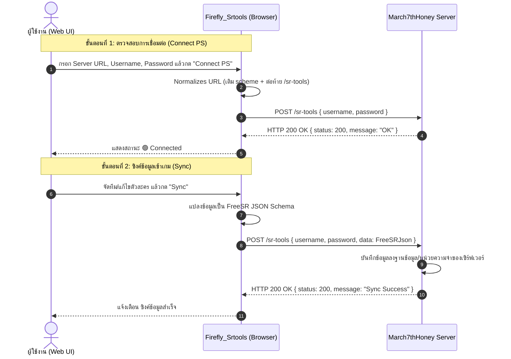

# เอกสารข้อมูลจำเพาะและการเชื่อมต่อ API: March7thHoney
> **Firefly_Srtools / SR-Tools to March7thHoney Integration Guide**

เอกสารฉบับนี้อธิบายรายละเอียดทางเทคนิคของโปรโตคอลการเชื่อมต่อ API ระหว่างเครื่องมือจัดการตัวละคร (**Firefly_Srtools / SR-Tools**) และเซิร์ฟเวอร์จำลอง **March7thHoney** (Honkai: Star Rail Private Server) โดยอ้างอิงจาก Source Code ล่าสุดของโปรเจกต์ `Firefly_Srtools`

---

## 1. ภาพรวมสถาปัตยกรรม (Architecture Overview)

ระบบการเชื่อมต่อแบบ **March7thHoney** ได้รับการออกแบบมาสำหรับการเชื่อมต่อแบบ Client-to-Server ผ่านทาง REST API โดยมีลำดับขั้นตอนหลัก 2 สถานะ:
1. **Connection Probe (Handshake):** ตรวจสอบการมีอยู่ของเซิร์ฟเวอร์ และยืนยันตัวตน (Authentication)
2. **Data Synchronization:** ส่งข้อมูลการจัดทีม, ตัวละคร, กรวยแสง, และรีลิกส์ (FreeSR Data Payload) เข้าสู่เซิร์ฟเวอร์

### ไดอะแกรมลำดับการทำงาน (Sequence Diagram)



---

## 2. ข้อมูลจำเพาะของ Endpoint (Endpoint Specification)

* **Path Suffix:** `/sr-tools`
* **HTTP Method:** `POST`
* **Request Content-Type:** `application/json`
* **Accept:** `application/json, text/plain`

### กฎการจัดรูปแบบ URL (URL Normalization Rules)
ในฟังก์ชัน `buildConnectUrl('March7thHoney', serverUrl)` ของระบบ:
1. **การเติม Scheme:** หากผู้ใช้ไม่ได้ระบุโปรโตคอล (`http://` หรือ `https://`) ระบบจะเติม `http://` ให้โดยอัตโนมัติ
2. **การตัด Trailing Slashes:** ตัดเครื่องหมาย `/` ส่วนเกินที่ท้าย URL ออก
3. **การตรวจสอบ Path ท้าย:** ตรวจสอบว่า URL ลงท้ายด้วย `/sr-tools` (Case-Insensitive) หรือไม่ หากยังไม่มีจะทำการเติม `/sr-tools` ต่อท้าย

**ตัวอย่างการแปลง URL:**
| ค่าที่ผู้ใช้กรอกใน UI | URL ปลายทางที่ระบบยิง Request |
| :--- | :--- |
| `localhost:21000` | `http://localhost:21000/sr-tools` |
| `http://127.0.0.1:21000/` | `http://127.0.0.1:21000/sr-tools` |
| `https://ps.example.com` | `https://ps.example.com/sr-tools` |
| `http://192.168.1.50:21000/sr-tools` | `http://192.168.1.50:21000/sr-tools` (ไม่เติมซ้ำ) |

---

## 3. รูปแบบข้อมูล Request Payload (Request Schemas)

### 3.1 การเชื่อมต่อครั้งแรก (Handshake / Connection Probe)
เมื่อผู้ใช้กดปุ่ม **"Connect PS"** จะเป็นการส่ง Request เพื่อตรวจสอบความถูกต้องของ URL และบัญชีผู้ใช้:

```json
{
  "username": "10001",
  "password": "UserPassword123"
}
```

* `username` *(string, required)*: ชื่อผู้ใช้ หรือ UID บัญชีในเกม
* `password` *(string, required)*: รหัสผ่านของบัญชีผู้ใช้
* `data` *(undefined)*: ในการ Probe เชื่อมต่อครั้งแรก จะไม่ส่งฟิลด์นี้

> [!NOTE]
> **การรักษาความปลอดภัยของรหัสผ่าน:** รหัสผ่านจะถูกจัดเก็บไว้ใน `sessionStorage` ชั่วคราวเท่านั้น และจะไม่ถูกเขียนลง `localStorage` ถาวร เพื่อป้องกันการถูกดึงข้อมูลเมื่อปิดเบราว์เซอร์

---

### 3.2 การส่งข้อมูลเข้าเซิร์ฟเวอร์ (Data Synchronization)
เมื่อผู้ใช้กดปุ่ม **"Sync"** ข้อมูลทีมและตัวละครจะถูกรวบรวมเป็นก้อน `FreeSRJson` แนบไปด้วย:

```json
{
  "username": "10001",
  "password": "UserPassword123",
  "data": {
    "avatars": [
      {
        "avatar_id": 1307,
        "level": 80,
        "rank": 6,
        "promotion": 6,
        "skills": {
          "1307001": 9,
          "1307002": 10,
          "1307003": 10,
          "1307004": 10
        },
        "equipment": {
          "tid": 23014,
          "rank": 5,
          "level": 80,
          "promotion": 6
        },
        "relics": [
          {
            "tid": 61121,
            "level": 15,
            "main_affix_id": 1,
            "sub_affixes": [
              { "sub_affix_id": 1, "cnt": 2, "step": 1 },
              { "sub_affix_id": 2, "cnt": 3, "step": 2 }
            ]
          }
        ]
      }
    ],
    "battle_type": "Stage",
    "stage_id": 1001,
    "lineup": [1307]
  }
}
```

> [!IMPORTANT]
> **ความแตกต่างระหว่าง March7thHoney และ FireflyGo:**
> โหมด `March7thHoney` จะส่งเพียง 3 ฟิลด์คือ `{ username, password, data }` เท่านั้น จะ**ไม่มี**การส่งก้อน `extra_data` (เช่น `multi_path` ของตัวเอก/March 7th หรือ `lua` script) ไปยังเซิร์ฟเวอร์

---

## 4. ข้อกำหนดการตอบกลับของ Server (Server Response Specification)

เพื่อให้ Client แสดงผลว่าเชื่อมต่อสำเร็จ เซิร์ฟเวอร์ต้องตอบกลับตามเกณฑ์ดังต่อไปนี้:

### 4.1 เกณฑ์การเชื่อมต่อสำเร็จ (Success Condition)
1. **HTTP Status Code:** ต้องอยู่ในช่วง `200` ถึง `299`
2. **Content Format:** ต้องเป็น JSON หรือ Text (ห้ามขึ้นต้นด้วย Tag HTML `<`)
3. **Response Body:** ไม่มีฟิลด์ `error` (หรือ `error` เป็นสตริงว่าง)

**ตัวอย่าง Response ที่ถูกต้อง:**
```json
{
  "status": 200,
  "message": "Connection established successfully"
}
```

หรือสามารถส่งสถิติสรุปตัวละครกลับมาได้:
```json
{
  "status": 200,
  "message": "Sync successful",
  "stats": {
    "avatars": 4,
    "created": 1,
    "updated": 3,
    "deleted": 0
  }
}
```

---

### 4.2 เกณฑ์การเชื่อมต่อล้มเหลว (Failure Condition)
Client จะถือว่าการเชื่อมต่อล้มเหลว (`success: false`) ทันทีเมื่อ:
* **HTTP Status >= 400:** เช่น 401 Unauthorized, 404 Not Found, 500 Internal Server Error
* **มี Error Field ใน JSON:** แม้ HTTP Status จะเป็น 200 แต่ถ้ามี `"error": "Invalid password"` จะถูกลดระดับเป็นสถานะ 400
* **ได้หน้า HTML กลับมา (HTML Detection):** หากเซิร์ฟเวอร์ส่งหน้าเว็บ 404/502 ของ Nginx หรือ Cloudflare ที่มีแท็ก `<html>` ฟังก์ชัน `looksLikeHtml()` จะดักจับและตัดการเชื่อมต่อทันที

---

## 5. ตัวอย่างการสร้างเซิร์ฟเวอร์รองรับ Endpoint `/sr-tools`

### 5.1 ตัวอย่างด้วย Node.js (Express)
```javascript
const express = require('express');
const cors = require('cors');
const app = express();

app.use(cors());
app.use(express.json());

// Endpoint สำหรับ March7thHoney
app.post('/sr-tools', (req, res) => {
  const { username, password, data } = req.body;

  // 1. ตรวจสอบข้อมูลการเข้าสู่ระบบ
  if (!username || password !== 'ExpectedPassword') {
    return res.status(401).json({
      status: 401,
      error: 'Invalid username or password'
    });
  }

  // 2. กรณี Handshake (Connect PS) - ยังไม่มี data ส่งมา
  if (!data) {
    return res.status(200).json({
      status: 200,
      message: 'March7thHoney handshake successful'
    });
  }

  // 3. กรณี Sync Data - บันทึกข้อมูลตัวละคร
  console.log(`Received FreeSR lineup for ${username}:`, data.avatars?.length, 'avatars');
  // บันทึกลง Database / Memory ของเซิร์ฟเวอร์...

  return res.status(200).json({
    status: 200,
    message: 'Data synchronized successfully',
    stats: {
      avatars: data.avatars?.length || 0,
      created: 0,
      updated: data.avatars?.length || 0,
      deleted: 0
    }
  });
});

app.listen(21000, () => console.log('March7thHoney SR-Tools API listening on port 21000'));
```

### 5.2 ตัวอย่างด้วย Python (FastAPI)
```python
from fastapi import FastAPI, HTTPException
from fastapi.middleware.cors import CORSMiddleware
from pydantic import BaseModel
from typing import Optional, Any, Dict

app = FastAPI()

app.add_middleware(
    CORSMiddleware,
    allow_origins=["*"],
    allow_methods=["*"],
    allow_headers=["*"],
)

class SRToolsPayload(BaseModel):
    username: str
    password: str
    data: Optional[Dict[str, Any]] = None

@app.post("/sr-tools")
async def handle_sr_tools(payload: SRToolsPayload):
    # ยืนยันตัวตน
    if payload.username != "10001" or payload.password != "SecretPass":
        raise HTTPException(status_code=401, detail="Authentication failed")
    
    # Handshake
    if payload.data is None:
        return {"status": 200, "message": "Handshake OK"}
    
    # Sync Data
    avatars_count = len(payload.data.get("avatars", []))
    return {
        "status": 200,
        "message": "Data synchronized successfully",
        "stats": {"avatars": avatars_count, "created": 0, "updated": avatars_count, "deleted": 0}
    }
```

---

## 6. ตารางเปรียบเทียบ Connection Types ใน Firefly_Srtools

| รูปแบบการเชื่อมต่อ | URL Endpoint เริ่มต้น | ต้องกรอก URL เอง? | ต้องกรอก Password? | รูปแบบ Payload |
| :--- | :--- | :---: | :---: | :--- |
| **FireflyGo** | `http://localhost:21000/sync` | ❌ อัตโนมัติ | ❌ ไม่ต้อง | ส่ง `extra_data` (Multi-path, Lua) |
| **RobinSR** | `http://localhost:21000/srtools` | ❌ อัตโนมัติ | ❌ ไม่ต้อง | ส่ง `extra_data` |
| **March7thHoney** | `{Server_URL}/sr-tools` |  ต้องกรอก |  ต้องกรอก | `{ username, password, data }` |
| **Collapse-RPG** | `{Server_URL}/query_connection` |  ต้องกรอก |  ต้องกรอก | แปลงเป็น `CollapseAvatarData` Schema |
| **Other** | `{Server_URL}` |  ต้องกรอก |  ต้องกรอก | ส่งแบบ Raw FreeSRJson หรือผ่าน Proxy |

---

## 7. ข้อควรระวังและการแก้ปัญหา (Troubleshooting)

1. **ปัญหา CORS (Cross-Origin Resource Sharing):**
   * หากเข้าใช้งาน Firefly_Srtools ผ่านเบราว์เซอร์บน Web Domain แต่ Server ของ March7thHoney รันอยู่ที่เครื่องอื่น ต้องเปิด Header `Access-Control-Allow-Origin: *` บนเซิร์ฟเวอร์
2. **ปัญหา Mixed Content (HTTP vs HTTPS):**
   * หากหน้าเว็บ Firefly_Srtools เปิดด้วย `https://` แต่เซิร์ฟเวอร์ March7thHoney เป็น `http://` เบราว์เซอร์จะบล็อกการยิง Request อัตโนมัติ ต้องใช้งานผ่าน `http://` เหมือนกัน หรือติดตั้ง SSL ให้กับเซิร์ฟเวอร์
3. **ปัญหา Private Host / Localhost:**
   * หากใช้งานโหมด Proxy ของเว็บ โฮสต์ที่เป็น Local IP (192.168.x.x, 127.0.0.1) จะยิงไม่ผ่าน ต้องเชื่อมต่อแบบ Local Mode เท่านั้น
